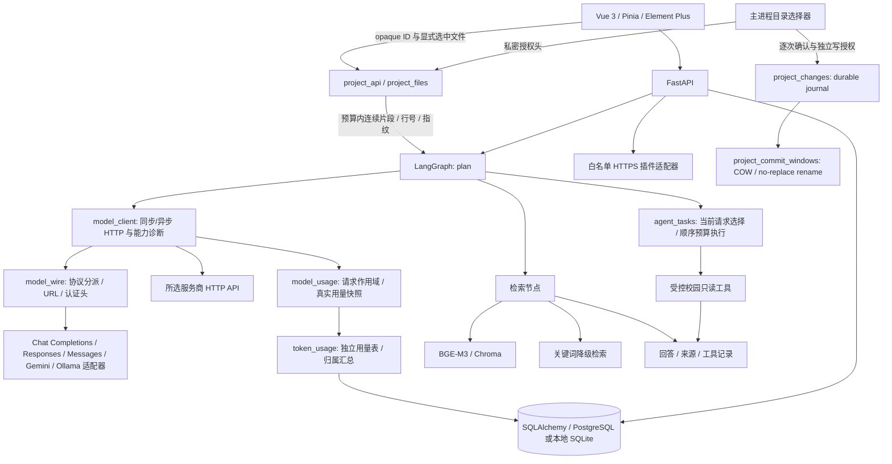

# 架构与接口

桌面模式新增 `desktop/main.cjs`（窗口、进程生命周期及受控 IPC）、`desktop/preload.cjs`（最小渲染桥）、`desktop/lib/backend.cjs`（后端进程管理）、`backend/desktop_entry.py`（随机端口、就绪握手及退出）、`app/desktop_runtime.py`（桌面鉴权与静态页面服务）。`scripts/build_desktop.py` 先运行测试，再经 PyInstaller + electron-builder 输出安装程序。桌面与网页共用业务 API；桌面模式的数据/配置和鉴权独立。详见 [DESKTOP.md](DESKTOP.md)。

`backend/app/main.py` 定义 API 与权限检查，`models.py` 定义会话、消息、文档、插件和报修表，`history_queries.py` 负责历史侧栏的有界 SQL 投影。`agent.py` 保留模型选择、工具注册及同步/流式共用的 LangGraph 准备节点；`provider_catalog.py` 统一后端服务商 ID、默认协议/地址与公开提示；`model_client.py` 负责同步/异步 HTTP 和已保存配置的能力诊断；`model_wire.py` 负责协议分派、路径和认证头。纯适配器为 `model_protocol.py`（Chat Completions/Ollama）、`model_responses.py`、`model_anthropic.py`、`model_gemini.py`，统一输出 canonical 文本/工具消息和 content/thinking 流；`rag.py` 负责索引版本管理和检索，`compiled_documents.py` 负责不可变分段及关键词预处理缓存；`plugins.py` 限制外部连接；`services.py` 是学校接口的替换位置。

这些拆分保留校园领域逻辑与桌面/网页共用 API。`model_runtime.py` 继续管理密钥、配置与下载，配置状态枚举采用一次操作内的新快照；不引入跨请求凭据缓存。前端 `ModelSettings.vue` 独立负责云端配置、兼容开关及诊断，`model-settings.ts` 放草稿/载荷/主机变更等纯规则；`App.vue` 保留共享配置与本地模型流程。

## 热点模块与性能边界（2026-10-31）

`history_queries.list_conversation_page()` 接受路由已解析的归属条件；先限定归属，在 SQL 中聚合消息总数及最大消息 ID，再按置顶、该最后消息的活动时间、会话 ID 升序取一页。最后消息时间为空时仍回退会话创建时间，无消息会话不显示。ID 升序明确了旧实现未显式保证的同时间分页顺序。第二条查询仅对本页缺少自定义标题的会话取第一条非空用户消息的有界标题前缀，保留 Python Unicode 去空白、首行及 40 字符规则，包括 SQLite 中的嵌入 NUL。每页最多两条 SQL，不加载完整回答、`result_data` 或所有消息 ORM 对象；账号归属、匿名 profile 与旧记录语义仍由原路由条件约束，搜索接口范围不变。

`model_runtime.configuration()` 在锁内读取一次 provider 存储，随后用私有 helper 从同一快照派生各项状态；28 家云端和 Ollama 共 29 次读存储降为 1 次。加密密钥仍逐项解密，环境默认值、清除密钥及坏存储错误保持原行为。快照只在该同步操作内存在；下一次状态/配置请求重新读文件，原子替换期间的单次枚举也不会混合新旧文件。

`agent.py` 的规划只在当前请求明确选中外部 MCP 工具且需要模型参数规划时调用模型。普通问答、项目问答、否定请求及无可用工具的请求直接进入知识意图；内置校园服务参数由当前消息确定，沿用预算执行器及单意图接口。对应普通云问答少一次此前结果被丢弃的规划请求，未放宽 MCP 选择、工具权限或规划上下文预算。

`compiled_documents.py` 保留带内容版本的不可变分段、token 集合和保守 Python 对象占用估计；默认预算为 32 MiB，另限 2,048 条。token 字符串仅在同一条目内复用，稳定准入避免超预算全库扫描反复淘汰。过大或未准入文档仍即时编译并正常参与排序。每次检索仍读取当前 SQL 文档，根据当前 ID 集合清除删除项，对检索检查的文档至多计算一次版本并复用于向量校验；标题/正文变化即换条目，不依赖更新时间。缓存不保留 ORM/session，读者持有不可变快照，编译及模型/网络调用不占全局缓存锁。缓存预算不包含 SQL 全文和在途读者，不能视为整个进程的内存上限。

文档版本使用 `campus-document-v2` 域与 UTF-8 标题长度边界，修复 NUL 分界歧义；这会主动使旧向量版本失效。版本不符的分段不能参与向量结果，关键词回退保持正确；重新索引文档或重建索引后恢复向量匹配。

前端 `src/ui.ts` 为生产与代表性集成测试注册同一组 19 个 Element Plus 组件及 Loading，沿用原 CSS 和消息/对话框 API。`ChatMarkdown.vue` 与 `chat-markdown.ts` 分离每条消息的解析边界：历史正文不变时不重解析，流式首段立即显示，随后最多每 80 ms 解析一次；结束、失败或停止时同步刷出准确最终正文，消息身份变化与卸载均清理旧定时器。原 Markdown、高亮与 DOMPurify 配置保留；聊天滚动合并为一个待执行调度。

`ProjectRecoveryList.vue` 合并本地收据、session revision 与父 revision 信号；同一活跃根目录最多一个在途列表请求。读取期间的新信号使当前结果失效，并安排一次后续读取；旧根目录、断开与卸载使排队任务及结果失效。后端恢复记录的当前授权、文件身份、完整 NTFS 哈希和待确认操作检查仍逐次执行，不缓存安全判断；未知操作覆盖及 copy-only 备份材料语义保持原样。

| 测量场景 | 重构前 | 重构后 |
| --- | --- | --- |
| 前端产出 JS / gzip 字节 | 1,430,135 / 449,828 | 853,863 / 275,318（JS −40.3%） |
| 合成 1,000 会话 / 40,000 消息，50 项页 | 1,001 SQL；320.293 ms | 2 SQL；9.083 ms |
| 配置状态枚举 | 29 次存储读取；28 次解密 | 1 次存储读取；28 次解密 |
| 合成知识库 100 文档 | 69.910 ms | 冷 90.768 ms / 暖 2.438 ms |
| 合成知识库 500 文档 | 336.510 ms | 冷 400.848 ms / 暖 26.599 ms |

耗时为合成微基准中位值。冷缓存与小预算可能引入预处理/计账开销，SQL 文档读取仍全量；构建体积变化不是桌面启动时间，未测真实模型服务延迟。最终后端 **1,349 passed、2 skipped、87 subtests passed**，前端 **298 passed**、桌面 **46 passed**，Vue 类型检查与生产构建通过；使用空配置和合成数据，未接触真实密钥/个人项目或调用真实模型/学校服务，安装包未重建。规格见[性能重构设计](superpowers/specs/2026-10-31-performance-refactor-design.md)，实测条件及限制见[结果报告](research/2026-10-31-performance-refactor-results.md)。

## 设置整合与 Token 统计（2026-10-31）

`SettingsShell.vue` 与 `settings-navigation.ts` 提供设置内部的五组导航：通用、模型、Token 用量、连接、数据与应用。桌面两栏、窄屏换行；分组使用 `v-show` 保留未保存的模型和连接表单，日志及高级诊断按需展开。`App.vue` 保留共享模型状态与动作，校园接口跳转先选中「连接」再定位目标，配置按首次进入加载，避免重新进入覆盖未保存草稿。`UsageSettings.vue` 在激活时读取统计，切换范围、客户端、离开页面或卸载时中止并使旧请求失效；`token-usage.ts` 负责响应校验、数字与图形计算，SVG 和明细表无需增加图表依赖。

`model_usage.py` 通过 `ContextVar` 为当前请求及复制上下文的工作线程提供 sink，`model_client.py` 在每次实际 HTTP 尝试结束时产生一次无正文用量记录。各协议保留最后一次累计快照，Anthropic 合并 start/delta 的数值字段，不将流式快照相加。普通消息流仍只有 content/thinking；usage 不进入回答正文。Chat Completions 读取 finish_reason 后的可选 usage-only 尾块，保留已有的合法文本结束与异常结束规则；仅显式 `request_options.stream_usage=true` 才发送 `stream_options.include_usage`，默认不向兼容网关添加参数。

`token_usage.py` 收集当前对话、规划和桌面项目草稿的尝试，在历史事务 commit/rollback 后写入独立 `TokenUsage` 表，避免 SQLite 自锁。嵌套流显式关闭下层异步生成器，停止或断线时先完成传输记账和历史收尾，再写用量。字段仅含归属、时间、服务商／模型／协议、操作、状态和可空计数，不存请求正文、密钥、地址或原始异常；写入统计失败只记录通用警告，不替代回答。新表通过可信 schema 增量创建，不与消息级联删除，旧备份缺此表仍可恢复为空表。

`GET /api/usage?client_id=…&days=7|30` 按 UTC 自然日汇总至当前时刻，不返回单条事件。返回总计、至多 30 个逐日项、最多 100 个模型组和一个「其他」汇总；SQL 聚合不加载全部事件。所有计数字段在完全未提供时保留 `null`，真实零保留 0；成功且输入／输出／总量齐全才属完整报告，失败／取消的中间快照和缺字段请求为部分报告，无计数则为未报告。各字段可覆盖不同请求；缓存／推理是细分项，不重复加到总量，原生协议按其计数口径规范化。

桌面统计本机应用所有无账号归属的记录（含没有 client_id 的项目草稿）；网站登录模式仅按服务端会话账号，忽略请求伪造的 client_id；匿名网站限定无 owner 且 client_id 相同。客户端隔离不构成多人认证。统计自功能启用起，不回填旧对话，不含连接诊断测试，不估算费用、余额或配额，停止／失败快照可能只反映已观察到的下限。详见[设置与用量记录](research/2026-10-31-settings-token-usage.md)。

## 项目、模型与界面接口

只读项目模块由 `project_files.py`（注册表、撤销、路径与打开句柄边界、文本预算）和 `project_api.py`（桌面身份与主进程授权边界）组成。主进程 `pickProject()` 只接受用户原生选择器的返回路径；渲染器不传根目录。`backend.openProject()` 闭包使用独立随机 `CAMPUS_PROJECT_GRANT_TOKEN` 注册根，不把 token 返回渲染器；普通桌面 token 只能列举/读取已授权 ID。单进程只有一个活跃项目，不把授权或绝对路径持久化。

Windows 用非 delete-sharing 目录句柄固定遍历路径，读取前对真实打开文件 handle 校验最终路径、卷、reparse 与链接数；POSIX 从根目录逐组件使用 dir_fd/O_DIRECTORY/O_NOFOLLOW，不能依赖读取前 realpath。目录只扫一层，最多展示300项、检查1200项；白名单 UTF-8 文本最多256KiB/文件、预览12000字符、单问最多4文件16000字符，按文件公平分配。拒绝生成/凭据目录、symlink/junction/硬链接和路径语法绕过。

ChatRequest.project={id,files} 在创建会话前校验并读取；普通与 SSE 都传入同一 project_sources 路径。选中项目时规划固定为知识回答，跳过 MCP 枚举和个人服务；文件内容仅为数据。最终模型预算对项目来源采用连续前缀，并同步重算 snippet/text/title/end_line/excerpt_sha256/truncated；文件读取已截断也反映在上下文报告。API 与历史只保留相对路径和实际片段引用，片段本身可能包含在本机对话备份中。重选/关闭/重启使旧 opaque ID 失效，历史重答不按路径名猜测项目。

`project_proposals.py` 是路线第3A阶段：只生成和审阅既有单文件的修改提案。`snapshot_file` 通过原有只读句柄取得完整 UTF-8 文本、原字节 SHA256、BOM/换行和文件 identity，限制 12000 字符、64 KiB、2000 行，不使用预览片段哈希。模型生成期间释放注册表锁，不调用工具/检索；只接受严格 JSON 的 replacement_text 与 summary。最终复验到 RAM 入库在 `unchanged_snapshot` 的短事务内保留目标、父目录句柄和注册表锁，open/close及缓存清理共享 grant_transaction，避免撤销后发布或旧关闭误清新授权。

提案最多32份、同时生成最多2个、30分钟过期，仅保存在进程内存。GET按完整原字节和identity重验，冲突时保留差异但标为conflict。关闭/重选立即清理旧授权提案；重启不恢复。前端 `ProjectProposalPanel.vue` 负责生成、审阅、版本检查后复制及显式应用入口；`ProjectDiff.vue` 以转义文本、行号及中性 +/− 标记展示完整差异，另可查看前后全文及编码变化。生成提案仍不写入项目、对话历史或浏览器存储；第3A阶段的ready/conflict与第3B阶段执行收据分开。

第3B阶段由 `project_commit_windows.py` 与 `project_changes.py` 实现，限 Windows 本地 NTFS 的既有单个白名单 UTF-8 文件，完整上限仍为12000字符、64 KiB、2000行。渲染器的目录授权保持只读；主进程独占独立随机 `CAMPUS_PROJECT_WRITE_TOKEN`，每次apply/revert/keep均原生确认，使用绑定当前grant、subject、动作和版本的digest及主进程UUID提交。普通桌面token不能执行prepare/commit，重复写授权头也拒绝。相同operation与绑定只查原结果；不同绑定、旧grant ticket或同提案新operation重放均拒绝。prepare从提案内部material保留原始identity，不能把同字节新inode当作原版本。

COW提交以 `OPEN_EXISTING` 和 READ/WRITE/DELETE、share=0 打开原文件，检查真实写权限、最终路径、卷、类型、身份和原字节哈希，父目录句柄贯穿操作。新随机暂存文件用 `CREATE_NEW` 创建，完成写入、flush及回读后，原文件通过自身handle无覆盖重命名至备份，暂存文件再通过自身handle无覆盖重命名至原名。原inode不写入，核验后新增的旧文件硬链接不会收到新正文。双rename不是崩溃原子事务：原名可短暂缺失；gap被新文件占位时，提交和恢复都不得覆盖它。仅清理已验证的内部对象；遗留stage/backup或无法证明结果时保留uncertain与恢复材料。

输入框的「项目权限」独立保存为本机 `projectPermission: 'read_only' | 'confirm'`；桌面默认confirm，网页版固定read_only。它只控制本应用原生项目apply/revert/keep，读取、提案、复制、状态查询和archive继续可用，不是OS、MCP或沙箱权限，也不提供full access。独立的 `setProjectPermission(mode)` 桥先在内存撤销只读切换的修改许可，再尝试磁盘保存；保存失败保持只读，confirm仅在持久化成功后启用。普通workspace快照不能用排队中的旧confirm覆盖当前原生权限，渲染器以revision防止迟到响应放权。主进程在prepare前、prepare后及原生确认返回后的commit前复验权限；等待期间切到只读会以 `project_change_read_only` 停止。保存失败可见且未解决时阻止重启flush。详见[项目权限规格](superpowers/specs/2026-10-31-project-permission-selector-design.md)。

元数据支持普通用户文件的owner/group、DACL及protected状态，以及相同mandatory integrity label；owner/group须与新暂存文件一致，复制后再次校验。除archive/normal外的特殊属性、只读/system/reparse/encrypted/compressed/sparse文件及命名ADS拒绝。可识别的SACL protected、自定义audit ACE、异常label或必需的owner/group/DACL/label/stream API失败均拒绝；不启用 `SeSecurityPrivilege`，非提权下不可读的自定义审计SACL不在支持范围，不能声称完整安全描述符保留。

`project-changes.sqlite3` 单独置于应用dataDir，使用stdlib sqlite3及 `synchronous=FULL`。原始字节、物理root/file identity、前后哈希、操作绑定及planned/prepared等阶段在相应文件变更前持久化，不保存绝对项目根路径。原字节恢复行最多32条未解决及32条已结束；已结束行可淘汰，操作ID小型tombstone继续防重放。恢复记录跨提案TTL、关闭和重启保留；用户原生重选同物理root后才能读取或撤销。revert须当前post identity和完整哈希匹配，旧版本只能复制原文或经确认keep；keep仅在单SQLite事务中结束恢复记录，不写项目文件。pending/uncertain按Windows规范化相对路径阻止新动作，GET只观察identity/哈希和内部材料是否遗留，不重放文件操作；分类的journal更新也是事务。待恢复原文是持久本机数据，不会为恢复再次发送模型。

第3C阶段由 `project_recovery_backup.py` 与备份接口提供可选的原文材料迁移。默认导出继续为 format 1，不含项目恢复原文；设置页复选框默认关闭。`GET /api/backup/export?include_project_recoveries=true` 生成 format 2，可附带 `project-recovery.json`。materials 只含物理根标识 `root_key`（两个非负整数的数组）、相对 `path`、`summary`、`created_at`、原字节 `sha256` 和 `original_base64`；不包含绝对根路径、操作ID、授权token、执行digest、暂存对象或可执行状态。原文来自一致性SQLite只读事务，覆盖live journal及此前导入的材料；导出不读取项目工作树，不分类或重放journal操作。

导入对JSON字段、重复键、base64、哈希、UTF-8、BOM及控制字符严格验证，材料另存 `dataDir/project-recovery-archive.sqlite3`。按物理root、相对path及原字节哈希生成确定性的 `backup_` + SHA-256 ID，事务去重并检查保留配额。每包及本机archive最多256条、原字节合计16 MiB；JSON最多25 MiB，单文件仍限64 KiB、12000字符、2000行。超限明确失败，不静默淘汰原文。导入只合并复制材料，不替换live `project-changes.sqlite3`、operation或防重放tombstone，不解除pending锁，不复活旧undo，不写项目文件；再导出可保留导入材料的原字节。

项目changes列表保留最多64条live `records`，增加最多256条可选 `archives`，仅返回 `archive_id/path/summary/created_at/size_bytes`，不包含原文或物理身份。主进程验证并逐字段构造公开数据，旧后端省略archives时补空数组；只有固定GET列表的私密传输上限为8 MiB，其它修改相关响应仍为1,000,000字节。原有original只读接口将 `backup_` ID分派至archive，返回同样的 `{text,bom,newline}`；prepare/commit不查询archive，伪造undo/keep请求即使带有效私密写token也拒绝。前端单列「备份原文材料」，只显示复制按钮，并在根切换、断连、卸载及剪贴板异步完成时复验上下文。必须原生重选同一物理root；另一设备或目录副本不自动关联。

备份发布在后端进程内串行化，每次请求独占快照、数据库/配置暂存目录。`campus.db` 经只读事务及SQLite backup API生成一致快照。导入先完成整个ZIP、清单、材料、数据库和配置暂存验证：拒绝重复/未知/路径/目录条目、加密及不支持压缩；有界读取单项与合计解压内容（200 MB），并验证清单声明的size/SHA-256。format 2要求精确清单对应，format 1保留旧版未列配置的兼容。上传SQLite仅按可信应用schema校验和重建数据，不执行其触发器/视图，再通过backup API发布。无效输入与配额失败发生在应用数据变更前；材料事务不改live恢复状态。运行时I/O可能报告部分应用/配置恢复，不保证跨数据库与文件系统的崩溃原子性。

云配置新增 `request_options`：输出长度字段二选一（`max_tokens` / `max_completion_tokens`）、是否发送 temperature、是否启用工具及流式。旧配置默认 max_tokens/true/true/true，读取不改写文件。关闭工具时使用确定性规划降级；关闭流式时仍通过异步 HTTP 发非流式请求并输出正文。所有调用与诊断复用同一构造器。原有 HTTPS、DPAPI 与换主机/端口必须换密钥或清除密钥的约束保持有效；接口只返回 api_key_set，清除密钥不保存其它未提交字段。

三种诊断分别验证正文响应、正常结束的流式正文、无副作用的 probe 工具调用。只把本次观察到的能力标为 verified，其它为 not_tested；没有工具调用只报告 tool_not_observed。诊断保留耗时、HTTP 状态、安全错误分类和建议，不回显上游正文或密钥。Ollama 原有测试仍只检查模型安装元数据，不表示通过聊天能力诊断。length/content_filter/未知终止与坏 JSON 不得伪装成功，已生成内容仍按 partial 保存。云端输出前失败的原有离线降级策略保留。

云配置同时保存 `protocol`；28 个云端槽含 13 家国内、14 个国际预设与自定义槽。自定义网关可选四种云协议。`request_options.max_output_tokens` 为严格 64..65536 整数、默认 900，原生协议自动映射为各自字段；字段名选项仅影响 Chat Completions。前端读取 catalog 分组展示，web/desktop 偏好、聊天/API 模型枚举保持一致并有契约测试。普通与流式问答入口的允许集也使用注册表，并逐厂商真实经过路由验证。新预设模型默认空，避免猜测具体账号权限。

公开 catalog.auth_header 只说明默认协议的认证头名称，不包含凭据、不开放任意请求头编辑。Xiaomi Chat Completions 使用 api-key 原值，其它新增国际 Chat 入口使用 Bearer；原生 Messages/Gemini 分别使用 x-api-key/x-goog-api-key。生产与所有诊断统一经 model_wire 构造。GLM 国内 zhipu 与国际 zai 独立存储；前端草稿读取完整 preset.request_options（已保存选项优先），避免显示出错误默认令牌字段或温度开关。

Responses 发送 store:false 与平铺 function 定义；Anthropic 使用 x-api-key/anthropic-version；Gemini 密钥只放 x-goog-api-key，完整工具 JSON Schema 放 parametersJsonSchema。三种原生流各自要求正常终态，断流/截断/refusal/坏数据不能冒充完成。Gemini/Anthropic 思考配置暂跟随供应商默认，Responses 深度请求 high/auto 摘要；不保证各模型全部推理扩展。DeepSeek 新版/自定义 model ID 原样发送，仅 exact deepseek-chat 保留旧深度别名映射；历史别名的当前可用性需要诊断，不能据此认定在线支持。范围与官方核验见 [支持矩阵](research/2026-10-31-model-support-matrix.md) 和 [国内接口](research/2026-10-31-domestic-model-providers.md)。

`agent_context.py` 生成模型发送视图：规划 8,000 字符、回答 24,000 字符，完整保留系统约束与当前问题，按完整轮次选择历史，对来源/附件分配独立上限，并保持返回来源与引用编号一致。这是字符预算，不是供应商实际 token 用量，也不保证覆盖所有模型窗口。API 从最近 40 条历史中提供候选；历史库不因裁剪而改变，部分回答带中断标识。用户问题与附件结构化分离，规划和检索不使用附件正文推断工具意图。附件仍只在当前请求可用，历史不保存正文；重新加载后需要重新附上才能重答附件问题。

`tool_policy.py` 根据本轮正文精确工具名及否定/解释语义限制 MCP 可见集合，最多 4 个定义且合计 12,000 字符；这是一层保守选择规则，不是通用自然语言授权系统。实际仍最多执行一个工具。JSON Schema 参数验证发生在进程启动前，拒绝非法定义、外部引用、非有限数及超过 8,192 字符的参数。工具发现和旧缓存均不会把坏 schema 转成宽松默认值。`agent_trace.py` 记录 plan/retrieve/tool/answer 状态与耗时，不记录密钥、原始错误响应或供应商费用。

`frontend/src/App.vue` 编排问答、校园服务、知识库、插件、MCP、账户和设置页面。`WorkspaceSidebar.vue` 负责导航与工具分组，`ConversationHistory.vue` 负责会话列表与管理操作；两者通过 props/emits 连接业务状态。`api.ts` 统一处理 HTTP 调用与错误，`store.ts` 保存模型偏好与会话身份，恢复失败时阻止自动覆盖原有状态。

`frontend/src/styles/tokens.css` 是黑白灰主题的统一颜色源，`appearance.ts` 选择浅色、深色或跟随系统，历史强调色字段仅为兼容旧配置保留。`style.css` 负责布局和组件外观；输入框内集中放置模型、附件、联网与推理选择。移动导航在关闭时退出键盘和读屏访问，短屏中部可滚动，页脚入口保持可见。

品牌矢量源为 `frontend/src/assets/mens-mark.svg`，`scripts/create_icon.py` 从同一几何生成桌面、PWA 与加载页资产。网页版的 `public/sw.js` 对页面采用网络优先策略，对带哈希的静态资源保留缓存，避免同版本重新构建后引用旧脚本。

| 方法 | 路径 | 说明 |
| --- | --- | --- |
| GET | /api/health | 后端与模型配置状态 |
| GET | /api/usage | 当前账号／匿名客户端或桌面本机的 7／30 天 UTC 用量汇总；可空计数、日趋势和有界模型分组，无原始事件 |
| POST | /api/chat | message、可选 conversation_id/model；返回 answer/sources/tool_calls/mode |
| POST | /api/chat/stream | SSE：meta、status、thinking/delta、done/error；status 提供preparing/querying/answering阶段，querying用于校园多读任务；断线保留已完成证据及真实partial/failed状态 |
| GET | /api/conversations | 当前登录用户或客户端的历史会话列表（title/message_count/updated_at） |
| DELETE | /api/conversations/{id} | 删除归属当前登录用户或客户端的单个会话 |
| DELETE | /api/conversations | 清空当前登录用户或客户端的会话 |
| GET | /api/conversations/{id} | 历史内容及来源和演示标识；客户端模式须传 client_id |
| GET/POST | /api/documents | 列表 / JSON 正文创建 |
| POST | /api/documents/upload | multipart file 上传（TXT / Markdown / PDF / docx，docx 用标准库解析段落文本） |
| PUT | /api/documents/{id}/upload | multipart file 替换 |
| PUT/DELETE | /api/documents/{id} | JSON 正文更新 / 删除 |
| POST | /api/documents/reindex | 重建当前文档索引 |
| GET | /api/backup/export | 默认format 1：campus.db一致快照、配置及size/SHA-256清单；include_project_recoveries=true导出format 2及可选JSON原文材料 |
| POST | /api/backup/import | 完整ZIP/清单/材料/可信schema数据库暂存验证后恢复应用数据，原文另库合并并返回新增/重复数量；配置变更需重启 |
| GET | /api/services/grades、schedule、credits | 演示校园查询 |
| GET | /api/services/classrooms | building、min_seats 筛选 |
| POST | /api/services/repairs | location、issue、contact 表单提交 |
| GET | /api/services/repairs | 本机报修记录（含联系方式，需管理员；桌面模式由桌面令牌自动授权） |
| GET | /api/update/check | 读取管理员配置的 HTTPS 更新清单（`UPDATE_MANIFEST_URL`）并比较版本；未配置时不联网 |
| GET | /api/web/status | 联网搜索是否启用、所选服务与可用性（聊天开关据此显示） |
| PUT | /api/web/config | 管理员启用/关闭联网搜索、切换 Bing/Tavily/博查、保存 API Key（DPAPI 加密） |
| GET/POST | /api/plugins | 插件列表 / JSON 清单直接登记 |
| POST | /api/plugins/install | 从 source HTTPS 清单地址安装 |
| PATCH/DELETE | /api/plugins/{id} | 启停或说明更新 / 卸载 |
| POST | /api/plugins/{name}/invoke | 管理员显式调用，正文为参数对象 |
| GET/PUT | /api/settings | 读取 / 修改本进程默认模型偏好 |
| GET/PUT | /api/models/config、/api/models/config/{provider} | 读取无密钥配置 / 管理员保存云端兼容选项或本地模型 |
| POST | /api/models/test/{provider} | 管理员诊断已保存配置；可选 capability=chat/streaming/tools，无请求体时默认 chat |
| GET | /api/projects | 桌面项目可用性与当前授权项目；网页不暴露项目 |
| POST | /api/projects/open | 主进程私密授权目录，不能仅用渲染器桌面 token 调用 |
| GET | /api/projects/{id}/files | 列举一个相对目录，不递归扫描 |
| POST | /api/projects/{id}/read | 本机只读预览，path 为相对文件路径 |
| POST | /api/projects/{id}/proposals | 按当前模型与推理档位生成既有单文件完整修改提案，desktop-only，不写文件 |
| GET | /api/projects/{id}/proposals/{proposal_id} | 获取不可变提案并复验原文件版本；返回ready/conflict，不重新调用模型 |
| POST | /api/projects/{id}/changes/prepare | 主进程私密写授权；准备apply/revert/keep绑定的审阅摘要和digest，不写项目文件 |
| POST | /api/projects/{id}/changes/commit | 主进程原生确认后提交digest与operation UUID；返回独立执行收据，重复operation不重写 |
| GET | /api/projects/{id}/changes/operations/{operation_id} | 当前物理root的操作收据；中断操作只分类，不重放写入 |
| GET | /api/projects/{id}/changes | 当前物理root最多64条live恢复records（can_revert复验）及最多256条copy-only archives元数据 |
| GET | /api/projects/{id}/changes/{recovery_id}/original | 只读取得原文/BOM/换行；backup_ ID从独立archive读取，只供复制 |
| DELETE | /api/projects/{id} | 撤销当前授权，旧 ID 不再可读 |

文档和插件写入、插件调用及设置更新需要 `X-Admin-Token`。前端模型偏好随每次问答发送，不修改服务器默认设置。启动后 `/docs` 为完整请求/响应模型的权威说明。

项目prepare/commit另需普通桌面鉴权及单个 `X-Campus-Project-Write`，该secret不进入渲染器。`/api/projects` 的 `changes_available` 仅在当前root为受支持NTFS且写secret有效时为true；读取恢复记录与备份原文材料不要求写secret。两种备份格式均不包含项目工作树或可执行的恢复journal；format 2仅可选携带受控原文JSON，不携带live journal数据库，也不由导入恢复旧写授权。

开启网站登录后，会话的 `owner_user_id` 由服务端登录会话确定，所有对话读写操作按该账号归属校验，不信任请求中的 `client_id`。桌面与免登录网页版仅能访问无账号归属且 `client_id` 匹配的记录；详情、导出与反馈接口也须传递 `client_id`。桌面客户端 ID 保存在 `workspace.json`，网页版保存在浏览器本地存储；它提供客户端隔离，不是多人身份认证。已有数据库通过可重复运行的增列迁移补齐 `owner_user_id`，不猜测历史记录属于哪个账号。旧的无归属记录在登录模式隐藏且不可认领；免登录模式保留原有首次续聊认领未分配历史的行为。当前没有账号历史自动迁移入口。

流式接口的普通规划与检索在工作线程中同步执行，模型输出用异步httpx逐段转发，客户端断开时停止上游模型请求并保留已有内容。P4A校园任务的准备由worker自建 `SessionLocal`，受取消感知的asyncio shield等待；断线立即设置 `ReadTaskControl.cancel()`，清理在AnyIO取消shield内等待worker收尾后再关闭其session。在途同步校园调用不被强杀，但不会再启动下一步；已完成结果与cancelled/partial状态真实落库，包括最后检查点与直接回答发布之间断线的情况。

文档数据库是权威数据源。索引用正文与标题的哈希区分版本，检索校验数据库中的最新内容，避免返回已删除或过期分段。SQL 保存后索引失败返回成功保存及 `index_status=pending`，不会误导客户端重复上传。

P4A由 `agent_tasks.py` 提供当前消息选择器、严格计划校验、`ReadTaskControl`和顺序执行器，`agent.py`共享准备路径在模型规划前识别多个明确请求的内置校园读取。四种服务为grades/schedule/credits/classrooms，按当前消息的提及顺序去重，最多3项不同尝试（失败也计数）；同时要求4项则0调用并要求缩小范围。历史、附件、项目文本、先前结果及模型提议不授予读取权限；否定、政策解释和文档/代码讨论排除个人查询。原有单服务规划也使用当前消息选择器；选定项目与明确点名单个MCP的路径继续独立，MCP仍最多执行一个工具。报修通过表单提交，插件通过显式管理接口调用。

执行前整体验证当前许可与规范参数，运行时再次去重。20,000 ms是每步启动前及返回后的协作式时间/取消检查，不是同步DNS/HTTP的硬超时；在途调用可超过预算，取消后不启动后续读取。无自动重试，计划与格式化不增加模型调用。仅保留已知服务字段，每项最多4,000字符、合计最多12,000结果字符并标记截短；各项独立标注demo或学校API，失败保留已有成功结果，不用演示值替代已配置接口失败，也不暴露原始供应商错误。没有持久续跑、MCP批处理或文件读取范围扩张。详见[P4A规格](superpowers/specs/2026-10-31-bounded-campus-reads-design.md)。

普通HTTP与SSE共用同一准备/执行/格式化路径，终态可选context/run保存在 `Message.result_data`。`RunTrace.task`只保留固定kind、次数/时间预算、计划/尝试/完成数、停止原因及截短数量；部分完成与全失败状态分别保留partial/failed，不被入口覆盖为completed。前端校验固定值、有限整数、数量关系和停止原因，移除未知字段；坏task不丢弃有效回答与run。`AgentDiagnostics`在原有折叠详情中显示次数、停止原因和截短提示，SSE的querying阶段有三语等待文案，旧记录无task时保持原界面。

联网搜索默认关闭，由管理员在设置中开启（也可用 `.env` 的 `WEB_SEARCH_*`），聊天窗口再按每条消息选择是否联网。开启后检索结果与知识库资料一起编号注入提示词（网页条目带链接与检索时间，模型被要求给出来源链接），知识库无依据时也会因网页资料而不再直接放弃回答。出站请求与插件同一套约束：仅 HTTPS、连接固定到校验过的公网地址（保留 SNI/主机名校验，防 DNS 重绑定）、禁止跳转、大小与超时上限；页面正文用标准库 HTMLParser 提取，单个网页最多保留 2000 字，API Key 用 DPAPI 加密保存在数据目录的 `web-search.json`。
